# Home Awareness

Sensors around a home listen locally for sounds a household cares about (a scream, breaking glass, a smoke alarm) and report short events to this server, which alerts each household member the way they chose: live in the browser, Telegram, or ntfy. Sensors send only the sound type, a confidence and a time; raw audio never reaches the server.

> Home-awareness tool. Not a medical device, security alarm, or emergency service. Cameras send a single snapshot only when they raise an alert.


This repository is the **FastAPI server core** (Plan 1): sign-up and households, invites, pairing and device keys, heartbeats, events, the rule engine (repeat counts, cooldowns, merging), alert delivery with retries, a live WebSocket feed, offline-sensor warnings, and Telegram linking. The laptop sensor and alert agent live in [`edge/`](edge/README.md) (Plan 2). The browser dashboard is served by the same app (see [Dashboard](#dashboard)). Design: [docs/design.md](docs/design.md). Competitor research: [docs/research/2026-11-07-competitors.md](docs/research/2026-11-07-competitors.md).

## Quick start

Needs Docker with Compose.

```bash
cp .env.example .env        # then set JWT_SECRET (see below)
docker compose up --build
```

Generate a secret with `python -c "import secrets;print(secrets.token_urlsafe(48))"` and put it in `.env` as `JWT_SECRET`. `.env.example` ships it empty on purpose: Compose refuses to start while `JWT_SECRET` is empty or missing, and the app refuses to start with a weak one (shorter than 32 characters or a placeholder such as `change-me`), because anyone who can guess the secret can sign in to any household. This starts Postgres, Redis, a one-shot `migrate` (`alembic upgrade head`), then the `api` (http://localhost:8000, interactive docs at `/docs`), a Celery `worker` and a Celery `beat` (runs the offline check every 60 s). If a host port is taken, override it: `DB_HOST_PORT`, `REDIS_HOST_PORT`, `API_HOST_PORT`. Email defaults to the console backend: sign-up confirmation links appear in `docker compose logs api`.

Configuration is environment variables only (see `.env.example` and `app/config.py`). `JOB_RUNNER=celery` (default, used by Compose) sends alert delivery to the worker; `inprocess` runs it inside the API process, for hosts without a worker.

## Upgrading to 1b

If you ran an earlier version:

1. **Migrate the database:** `alembic upgrade head` (Compose's one-shot `migrate` service does this on `docker compose up`; outside Compose run `uv run alembic upgrade head`).
2. **Telegram:** the server now also requires Telegram's `X-Telegram-Bot-Api-Secret-Token` header, so re-run the `setWebhook` call from [Telegram bot](#telegram-bot-optional) step 4 **with** `secret_token=<SECRET>`; until you do, Telegram updates (linking) are rejected. `TELEGRAM_WEBHOOK_SECRET` may now only contain `A-Z a-z 0-9 _ -` (1–256 characters) and the server refuses to start with any other character; if yours has others, pick a new one and update both `.env` and the webhook.
3. **Laptop agents:** re-run `ha-agent login` on each laptop to replace the old 24-hour login with a long-lived agent token (old configs keep working until they expire, then `ha-agent run` asks you to log in again).
4. **Sensors:** already-paired `ha-sensor` laptops keep working; nothing to do.

## Dashboard

A plain HTML/CSS/JavaScript app (no framework, no bundler, no CDN scripts) served by the API itself, on the same origin. With the stack running, open **http://localhost:8000/app/** (`/` redirects there), sign up, confirm the link from the console email (`docker compose logs api | grep token=`), and log in. The login token lives in `sessionStorage` only. It works from 360 px phones to laptops and follows the system light or dark theme.

| Page | What it does |
| --- | --- |
| Overview | Live status of the household: sensors online, offline or waiting to pair, today's counts, a live event table and which alert channels are on. |
| Sounds & rules | Switch each sound on or off, and set its minimum confidence, repeat count, window and cooldown. |
| Sensors | Create an 8-character pairing code for a new sensor (with a countdown), see each sensor's state, and remove sensors. |
| Alert channels | Popup and alarm sound in the browser, Telegram link, ntfy topic, browser notifications, a test alert, and laptop agent tokens. |
| Household | Members and invite links, the household time zone, removing members, and leaving or deleting the household. |
| Alert screen | A full-screen, dark, assertive alert on every page when a sound alerts you: "I'm on it", event details, dismiss. |

| View | Phone (390 px) | Laptop (1280 px) |
| --- | --- | --- |
| Overview | 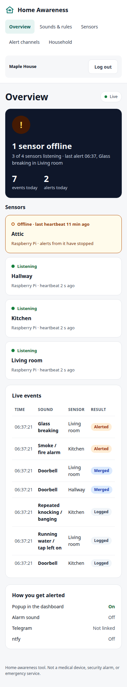 | 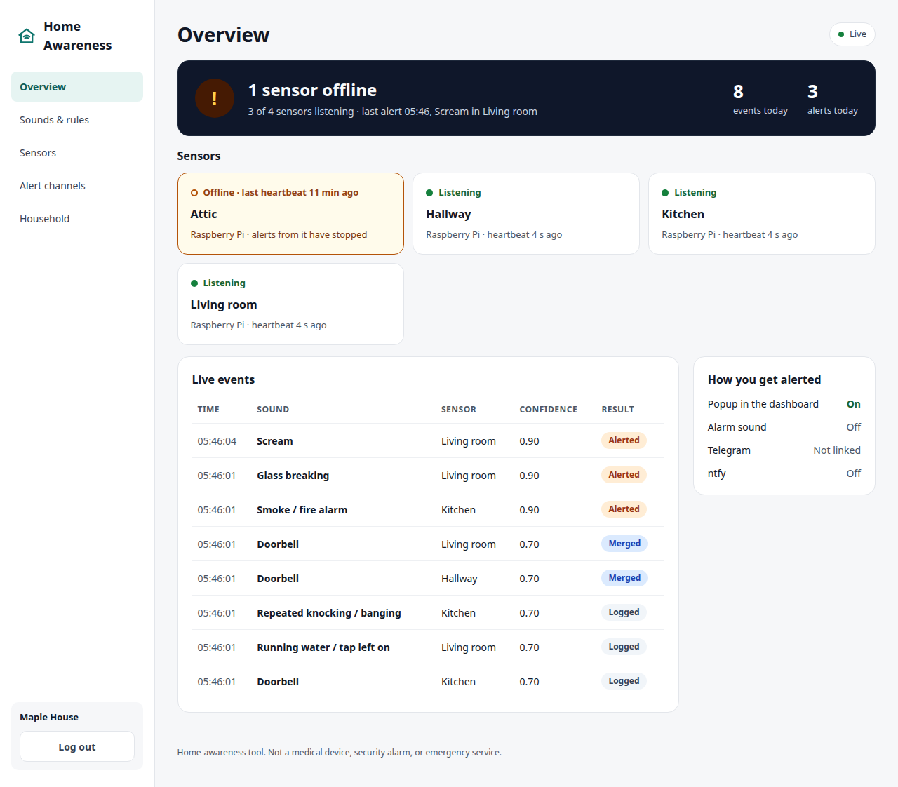 |
| Sounds & rules | 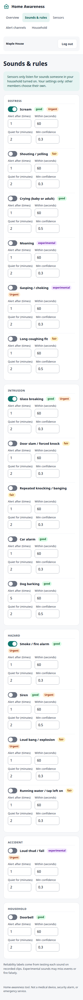 | 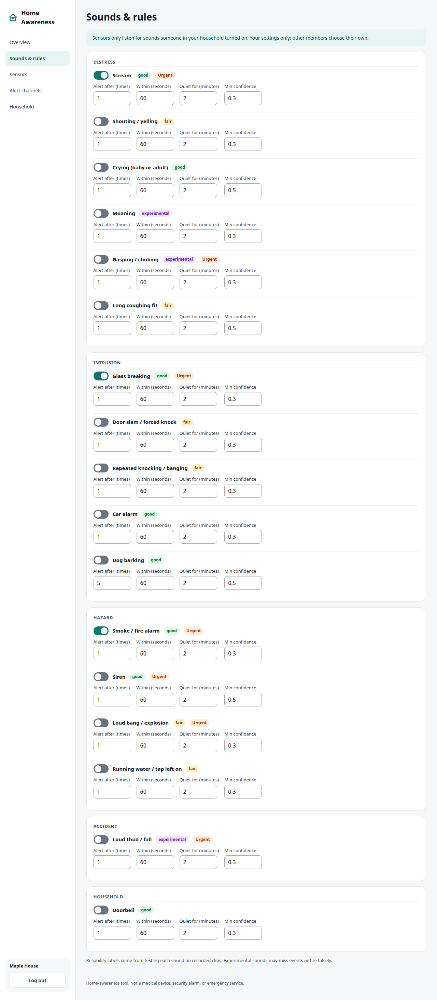 |
| Sensors | 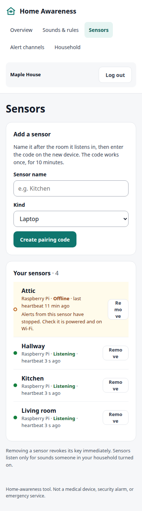 | 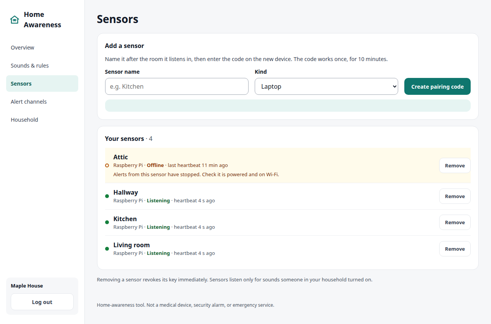 |
| Alert channels | 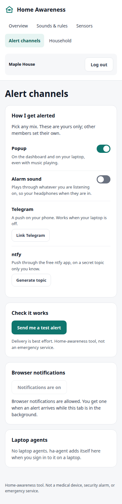 | 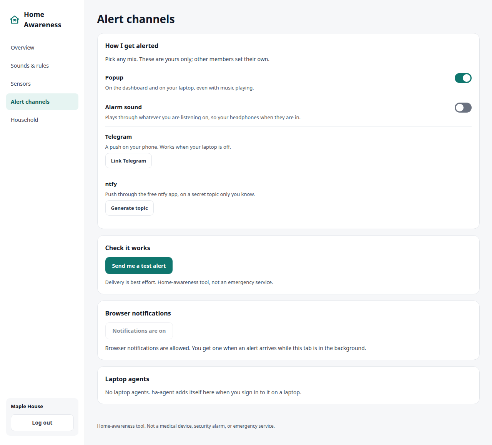 |
| Household | 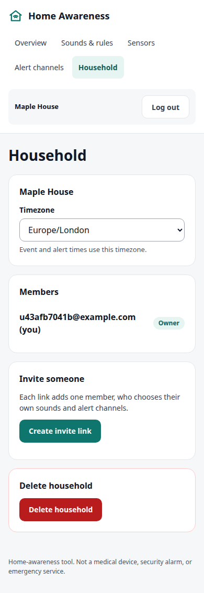 | 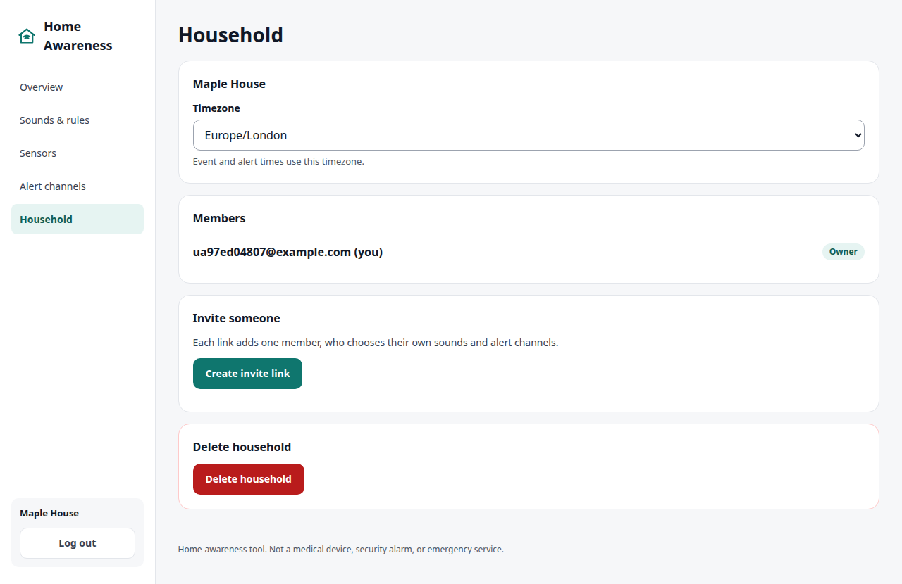 |
| Alert screen | 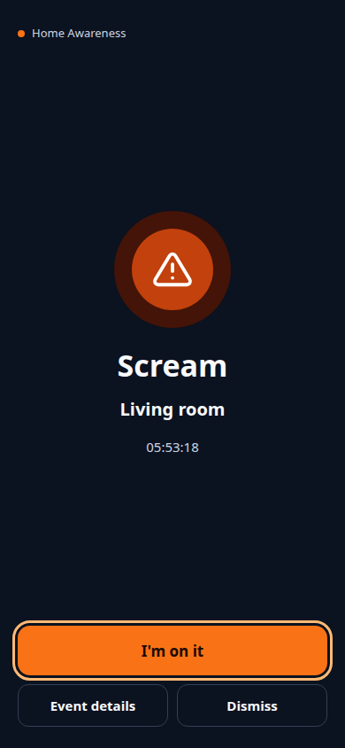 | 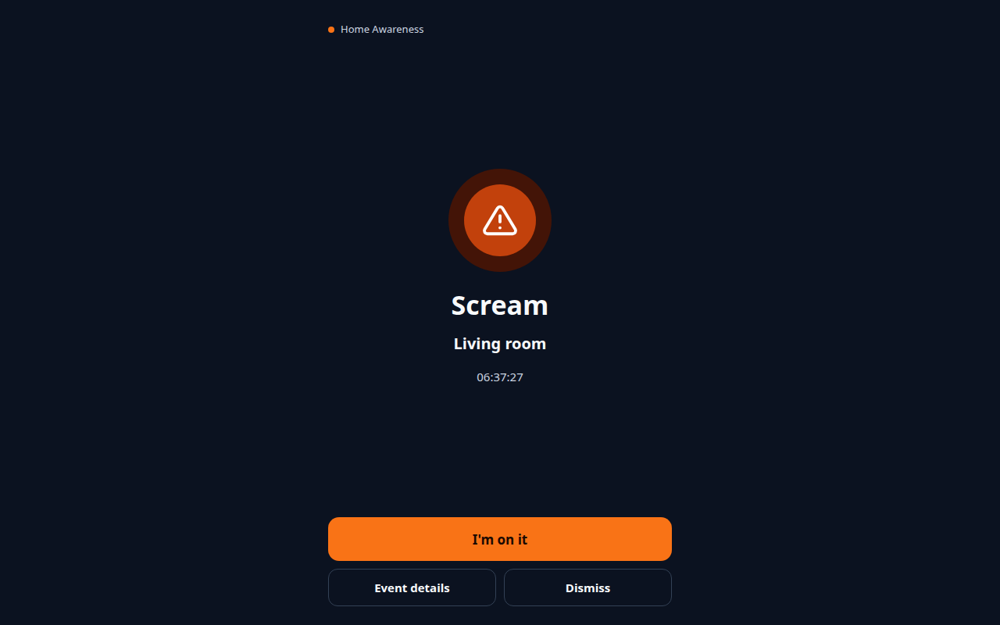 |
| Log in | 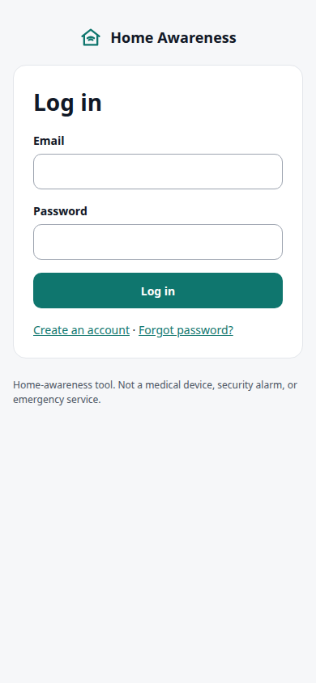 | 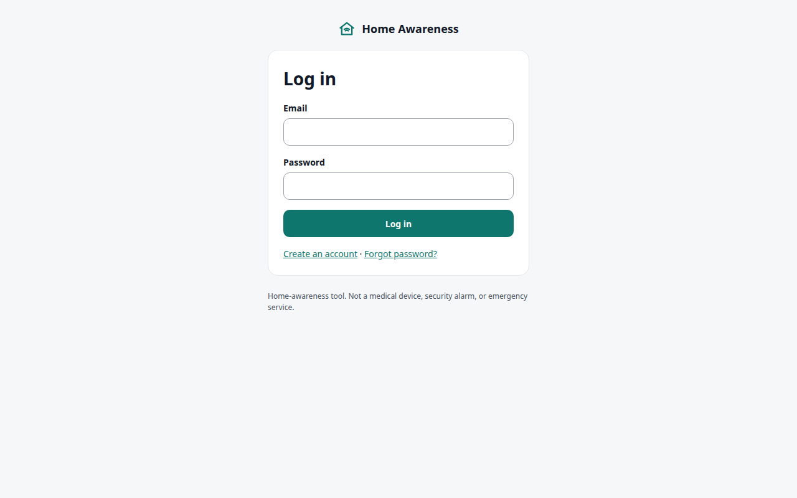 |
| Sign up | 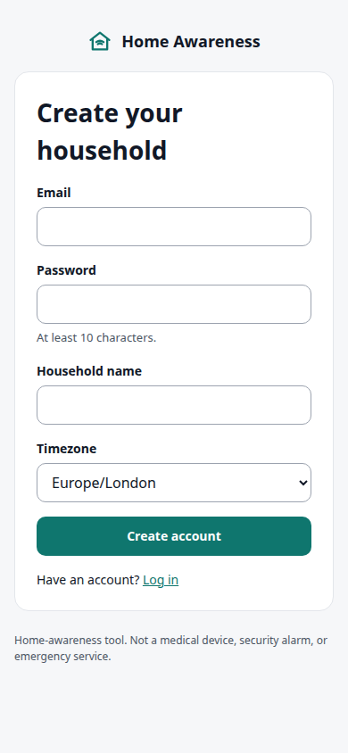 | 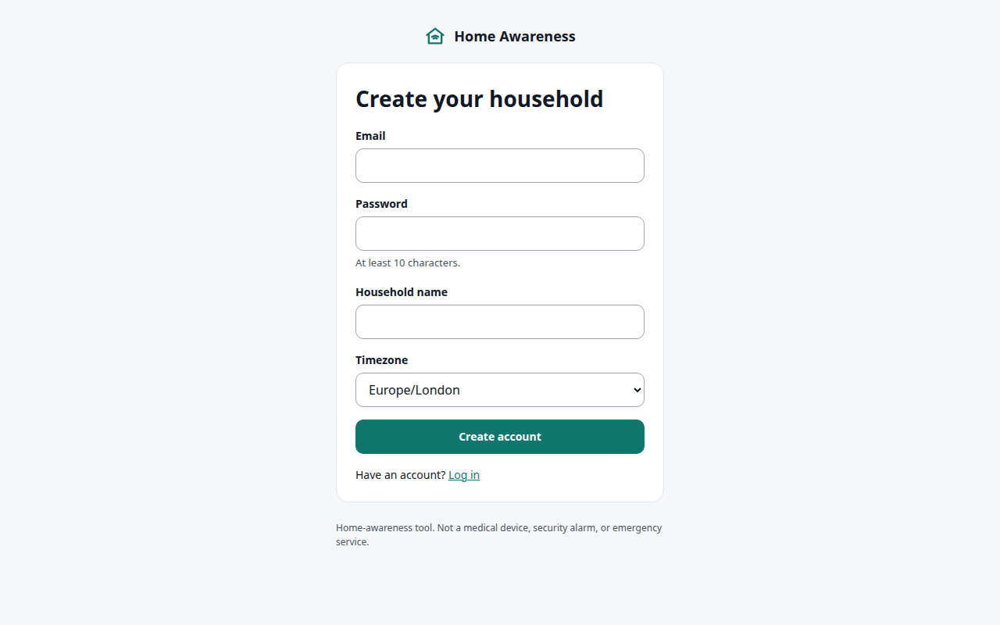 |

The screenshots show a made-up demo household. Regenerate them with `uv run python scripts/dashboard_screenshots.py` (needs Postgres and Google Chrome; it uses the `home_test` database like the tests and empties it afterwards).

## Laptop sensor and alert agent

[`edge/`](edge/README.md) is a separate Python package with two commands for Linux laptops (PipeWire): `ha-sensor` turns a laptop into a sound sensor (pair it with a code from `POST /devices/pairing-codes`; it runs YAMNet locally and sends only the sound type, a confidence and a time), and `ha-agent` shows your alerts as desktop popups and plays an alarm through your headphones. Setup, exit codes and caveats: [edge/README.md](edge/README.md). Per-sound accuracy measurements: [docs/accuracy.md](docs/accuracy.md).

## Camera sensor

`ha-camera` (in [`edge/`](edge/README.md#camera-sensor-ha-camera)) turns a Linux laptop webcam or USB camera into a sensor for falls, lying still and a person while the house is Away or at night. Video is analysed on the device and never leaves it. Cameras send a single snapshot only when they raise an alert, if the camera's "Send snapshots" switch is on (see [Camera snapshots](#camera-snapshots-optional)). Usage and honest limits: [edge/README.md](edge/README.md#camera-sensor-ha-camera); a morning test checklist: [docs/camera-live-test.md](docs/camera-live-test.md); try camera alerts without a camera with `scripts/fake_camera.py`; design: [camera spec](docs/superpowers/specs/2026-11-08-camera-sensors-design.md).

## Telegram bot (optional)

1. In Telegram, message [@BotFather](https://t.me/BotFather), send `/newbot`, and follow the prompts. Copy the bot token and the bot username.
2. Pick a long random string as the webhook secret.
3. In `.env` set `TELEGRAM_BOT_TOKEN`, `TELEGRAM_BOT_USERNAME` and `TELEGRAM_WEBHOOK_SECRET`, then restart the stack.
4. Point Telegram at your server (it must be reachable over HTTPS, e.g. via a tunnel):
   `curl "https://api.telegram.org/bot<TOKEN>/setWebhook" --data-urlencode "url=<PUBLIC_BASE_URL>/telegram/webhook/<SECRET>" --data-urlencode "secret_token=<SECRET>"`
   Telegram then sends the secret back in the `X-Telegram-Bot-Api-Secret-Token` header on every update; the server rejects (404) any request without both the path secret and that header. The secret may only contain `A-Z a-z 0-9 _ -`, 1–256 characters (Telegram's rule for `secret_token`); the server refuses to start with any other character. `python -c "import secrets;print(secrets.token_urlsafe(48))"` makes a suitable one. If you set the webhook before this header check existed, run the call again.
5. Signed in, call `POST /me/telegram/link` to get a link, open it in Telegram and press Start.

The bot token and webhook secret are kept out of logs.

## Camera snapshots (optional)

A camera sensor may attach one JPEG (at most 300 KB, 640 px on the longest side) to an alerting event; no video ever reaches the server. The server keeps it encrypted (Fernet) on disk, shows it to household members, and uploads it to Telegram (`sendPhoto`) and ntfy (an attachment) with the alert; it never sends a link.

1. Generate a key and put it in `.env` as `SNAPSHOT_KEY`:
   `python -c "from cryptography.fernet import Fernet; print(Fernet.generate_key().decode())"`
   Keep it safe: without it stored snapshots cannot be read. If `SNAPSHOT_KEY` is set but not a valid key, the server refuses to start; if it is unset, events are accepted and images are dropped (one warning in the log).
2. Images live in the `snapshots` Docker volume (`/data/snapshots`, shared by `api` and `worker`; compose mounts it at a fixed `/data/snapshots`, so leave `SNAPSHOT_DIR` at its default there and change it only when running without compose). Back it up with the database if you want to keep images.
3. Each household chooses how long images are kept (1, 7 or 30 days, default 7) and is capped at 200 MB; the oldest images go first. The worker's 5-minute sweep applies both, and also removes files left behind by a deleted household or event after a day.
4. Privacy: an ntfy topic is public by name, and ntfy.sh keeps attachments for hours, so anyone who guesses the topic can see the photo. Use a long random topic, a self-hosted ntfy (`NTFY_BASE_URL`), or turn snapshots off for that camera.
5. Fetch an image with `GET /snapshots/{event_id}` and a member's Bearer token or an agent token (`Cache-Control: private, no-store`).

## Security

- A password reset (`POST /auth/password-reset/confirm`) signs out every session: all login tokens stop working and all `ha-agent` tokens are revoked. Pending invites created by that member are deleted.
- A reset deliberately does **not** change your alert channels: rotating the ntfy topic or unlinking Telegram automatically could silently stop alerts reaching your real phone. Instead the response carries `{"check_alert_channels": true}` and you get an email saying the password was changed. If someone else had access to your account, regenerate your ntfy topic and check your Telegram link in Alert channels (`POST /me/alert-preferences/ntfy-topic`, then update the ntfy app; `GET /me/alert-preferences`, and `DELETE /me/telegram` plus a fresh link if the chat is not yours).

## Urgent sounds and quiet phones

Sounds marked `severity: "urgent"` in `GET /sounds` (scream, glass breaking, smoke alarm, siren, loud bang / explosion, loud thud / fall, gasping) are pushed to ntfy with its highest priority (`Priority: urgent`, tag `rotating_light`); all other sounds, test alerts and sensor status messages use `high`. Whether that vibrates or breaks through silent / do-not-disturb depends on the notification settings of your ntfy app on the phone. Telegram has no priority levels, so its messages are the same for every sound. If your phone is often on silent, use ntfy for urgent sounds.

## Running tests

Tests need Postgres (a `home_test` database, created by `docker/initdb`) and use fakeredis, so Redis is not required.

```bash
cp -n .env.example .env   # then set JWT_SECRET: compose refuses to start, even for db only, while it is empty
docker compose up -d db
uv sync
uv run pytest -q && uv run ruff check .
```

The dashboard tests (`tests/web`, marked `web`) drive Google Chrome through Playwright and skip cleanly when Chrome is not installed.

`TEST_DATABASE_URL` must name a database ending in `_test`; the suite drops and recreates its tables and refuses to run otherwise.

## Behaviour notes

- Rate limits answer `429` with a `Retry-After` header (seconds until the window resets). Events are limited to 60 a minute per sensor and 300 a minute per household.
- Alert texts give the time in UTC. Alerts that could not be delivered within 10 minutes are marked `failed` and never sent late.
- After the server (or its database) restarts, no sensor is reported offline until it has had a full 180 s to check in again.

## Observability

- `GET /health` checks Postgres and Redis.
- `GET /metrics` serves Prometheus counters: `ha_events_received_total{sound}`, `ha_events_merged_total`, `ha_alerts_created_total{sound}`, `ha_deliveries_total{channel,status}`, `ha_devices_offline_total`. Do not expose `/metrics` publicly; restrict it at your reverse proxy.
- **Limitation:** each process has its own metrics registry. With Celery, delivery and offline-check counters (`ha_deliveries_total`, `ha_devices_offline_total`) are incremented in the worker/beat processes, so the API's `/metrics` does not show them. The event and alert counters are incremented in the API and are visible. Aggregating across processes is out of scope for now.
- Each request logs one JSON line (`method`, `path`, `status`, `duration_ms`, `request_id`). `path` is the matched route template (for example `/telegram/webhook/{secret}`), never the raw URL, so tokens in paths and query strings (`/ws?token=...`) stay out of logs. No headers or bodies are logged. The Docker image runs uvicorn with `--no-access-log` for the same reason, the app sets uvicorn's own `uvicorn.error` logger to `WARNING` (at `INFO` it logs every WebSocket path including `?token=`), and every log line in every process has `token=<value>` masked to `token=***` as a backstop. The console email backend prints straight to stderr, outside logging, so its links stay usable in development. The `request_id` is also returned as the `X-Request-ID` response header.

## Manual end-to-end walkthrough

1. `docker compose up --build -d`, then `curl localhost:8000/health`.
2. Sign up at `/docs` (`POST /auth/signup`). Find the confirmation token in the console email: `docker compose logs api | grep token=`. `POST /auth/confirm` with it (lost or expired link: `POST /auth/confirm/resend` with `{"email": ...}` sends a fresh one and retires the old), then `POST /auth/login` and use the returned token as the bearer token (the Authorize button in `/docs`).
3. `POST /devices/pairing-codes` (`{"name": "Kitchen", "kind": "pi"}`) returns an 8-character code.
4. Start a fake sensor: `uv run python scripts/fake_sensor.py --base-url http://localhost:8000 --code <CODE> --sound scream`. It pairs (saving the device key to the git-ignored `.fake_sensor_key`, never printing it), sends the event(s), then heartbeats every 60 s until Ctrl-C. Options: `--count`, `--interval`, `--once` (exit after the events). Without `--code` it reuses the saved key.
5. Expect the event response `202` with `"alerts": 1`. With a WebSocket client connected (see below), `GET /alerts` shows the alert `sent` with a `websocket` delivery; with nobody connected the websocket delivery is `failed` (`no live listener`), because a popup no one sees reached no one. `GET /metrics` shows the counters.
6. Stop the sensor (Ctrl-C). A sensor is marked `offline` after 180 s without a heartbeat, but only while the server is still hearing from some other sensor; when every sensor on the server has gone quiet the server assumes it was itself unreachable and waits until nothing has been heard for 10 minutes. After any such silence (or a failed check) the server also waits a further 180 s before marking anyone, so every sensor gets a full window to check in again. With this single fake sensor, `GET /devices` shows it `offline` after about 13 minutes. Restart it and members get "✅ Sensor … is back online." on their external channels.
7. `docker compose down` (add `-v` to delete the database volume).

For a live feed, connect a WebSocket client to `ws://localhost:8000/ws?token=<login token>`.
