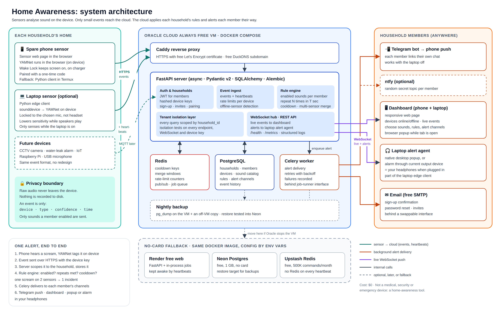

# Home Awareness

Sensors around a home listen locally for sounds a household cares about (a scream, breaking glass, a smoke alarm) and report short events to this server, which alerts each household member the way they chose: live in the browser, Telegram, or ntfy. Sensors send only the sound type, a confidence and a time; raw audio never reaches the server.

> Home-awareness tool. Not a medical device, security alarm, or emergency service.



This repository is the **FastAPI server core** (Plan 1): sign-up and households, invites, pairing and device keys, heartbeats, events, the rule engine (repeat counts, cooldowns, merging), alert delivery with retries, a live WebSocket feed, offline-sensor warnings, and Telegram linking. The laptop sensor and alert agent live in [`edge/`](edge/README.md) (Plan 2); the dashboard comes in a later plan. Design: [docs/design.md](docs/design.md). Competitor research: [docs/research/2026-11-07-competitors.md](docs/research/2026-11-07-competitors.md).

## Quick start

Needs Docker with Compose.

```bash
cp .env.example .env        # then set JWT_SECRET (see below)
docker compose up --build
```

Generate a secret with `python -c "import secrets;print(secrets.token_urlsafe(48))"` and put it in `.env` as `JWT_SECRET`. `.env.example` ships it empty on purpose: Compose refuses to start while `JWT_SECRET` is empty or missing, and the app refuses to start with a weak one (shorter than 32 characters or a placeholder such as `change-me`), because anyone who can guess the secret can sign in to any household. This starts Postgres, Redis, a one-shot `migrate` (`alembic upgrade head`), then the `api` (http://localhost:8000, interactive docs at `/docs`), a Celery `worker` and a Celery `beat` (runs the offline check every 60 s). If a host port is taken, override it: `DB_HOST_PORT`, `REDIS_HOST_PORT`, `API_HOST_PORT`. Email defaults to the console backend: sign-up confirmation links appear in `docker compose logs api`.

Configuration is environment variables only (see `.env.example` and `app/config.py`). `JOB_RUNNER=celery` (default, used by Compose) sends alert delivery to the worker; `inprocess` runs it inside the API process, for hosts without a worker.

## Laptop sensor and alert agent

[`edge/`](edge/README.md) is a separate Python package with two commands for Linux laptops (PipeWire): `ha-sensor` turns a laptop into a sound sensor (pair it with a code from `POST /devices/pairing-codes`; it runs YAMNet locally and sends only the sound type, a confidence and a time), and `ha-agent` shows your alerts as desktop popups and plays an alarm through your headphones. Setup, exit codes and caveats: [edge/README.md](edge/README.md). Per-sound accuracy measurements: [docs/accuracy.md](docs/accuracy.md).

## Telegram bot (optional)

1. In Telegram, message [@BotFather](https://t.me/BotFather), send `/newbot`, and follow the prompts. Copy the bot token and the bot username.
2. Pick a long random string as the webhook secret.
3. In `.env` set `TELEGRAM_BOT_TOKEN`, `TELEGRAM_BOT_USERNAME` and `TELEGRAM_WEBHOOK_SECRET`, then restart the stack.
4. Point Telegram at your server (it must be reachable over HTTPS, e.g. via a tunnel):
   `curl "https://api.telegram.org/bot<TOKEN>/setWebhook?url=<PUBLIC_BASE_URL>/telegram/webhook/<SECRET>"`
5. Signed in, call `POST /me/telegram/link` to get a link, open it in Telegram and press Start.

The bot token and webhook secret are kept out of logs.

## Urgent sounds and quiet phones

Sounds marked `severity: "urgent"` in `GET /sounds` (scream, glass breaking, smoke alarm, siren, loud bang / explosion, loud thud / fall, gasping) are pushed to ntfy with its highest priority (`Priority: urgent`, tag `rotating_light`); all other sounds, test alerts and sensor status messages use `high`. Whether that vibrates or breaks through silent / do-not-disturb depends on the notification settings of your ntfy app on the phone. Telegram has no priority levels, so its messages are the same for every sound. If your phone is often on silent, use ntfy for urgent sounds.

## Running tests

Tests need Postgres (a `home_test` database, created by `docker/initdb`) and use fakeredis, so Redis is not required.

```bash
cp -n .env.example .env   # then set JWT_SECRET: compose refuses to start, even for db only, while it is empty
docker compose up -d db
uv sync
uv run pytest -q && uv run ruff check .
```

`TEST_DATABASE_URL` must name a database ending in `_test`; the suite drops and recreates its tables and refuses to run otherwise.

## Behaviour notes

- Rate limits answer `429` with a `Retry-After` header (seconds until the window resets). Events are limited to 60 a minute per sensor and 300 a minute per household.
- Alert texts give the time in UTC. Alerts that could not be delivered within 10 minutes are marked `failed` and never sent late.
- After the server (or its database) restarts, no sensor is reported offline until it has had a full 180 s to check in again.

## Observability

- `GET /health` checks Postgres and Redis.
- `GET /metrics` serves Prometheus counters: `ha_events_received_total{sound}`, `ha_events_merged_total`, `ha_alerts_created_total{sound}`, `ha_deliveries_total{channel,status}`, `ha_devices_offline_total`. Do not expose `/metrics` publicly; restrict it at your reverse proxy.
- **Limitation:** each process has its own metrics registry. With Celery, delivery and offline-check counters (`ha_deliveries_total`, `ha_devices_offline_total`) are incremented in the worker/beat processes, so the API's `/metrics` does not show them. The event and alert counters are incremented in the API and are visible. Aggregating across processes is out of scope for now.
- Each request logs one JSON line (`method`, `path`, `status`, `duration_ms`, `request_id`). `path` is the matched route template (for example `/telegram/webhook/{secret}`), never the raw URL, so tokens in paths and query strings (`/ws?token=...`) stay out of logs. No headers or bodies are logged. The Docker image runs uvicorn with `--no-access-log` for the same reason. The `request_id` is also returned as the `X-Request-ID` response header.

## Manual end-to-end walkthrough

1. `docker compose up --build -d`, then `curl localhost:8000/health`.
2. Sign up at `/docs` (`POST /auth/signup`). Find the confirmation token in the console email: `docker compose logs api | grep token=`. `POST /auth/confirm` with it (lost or expired link: `POST /auth/confirm/resend` with `{"email": ...}` sends a fresh one and retires the old), then `POST /auth/login` and use the returned token as the bearer token (the Authorize button in `/docs`).
3. `POST /devices/pairing-codes` (`{"name": "Kitchen", "kind": "pi"}`) returns an 8-character code.
4. Start a fake sensor: `uv run python scripts/fake_sensor.py --base-url http://localhost:8000 --code <CODE> --sound scream`. It pairs (saving the device key to the git-ignored `.fake_sensor_key`, never printing it), sends the event(s), then heartbeats every 60 s until Ctrl-C. Options: `--count`, `--interval`, `--once` (exit after the events). Without `--code` it reuses the saved key.
5. Expect the event response `202` with `"alerts": 1`. With a WebSocket client connected (see below), `GET /alerts` shows the alert `sent` with a `websocket` delivery; with nobody connected the websocket delivery is `failed` (`no live listener`), because a popup no one sees reached no one. `GET /metrics` shows the counters.
6. Stop the sensor (Ctrl-C). A sensor is marked `offline` after 180 s without a heartbeat, but only while the server is still hearing from some other sensor; when every sensor on the server has gone quiet the server assumes it was itself unreachable and waits until nothing has been heard for 10 minutes. After any such silence (or a failed check) the server also waits a further 180 s before marking anyone, so every sensor gets a full window to check in again. With this single fake sensor, `GET /devices` shows it `offline` after about 13 minutes. Restart it and members get "✅ Sensor … is back online." on their external channels.
7. `docker compose down` (add `-v` to delete the database volume).

For a live feed, connect a WebSocket client to `ws://localhost:8000/ws?token=<login token>`.
