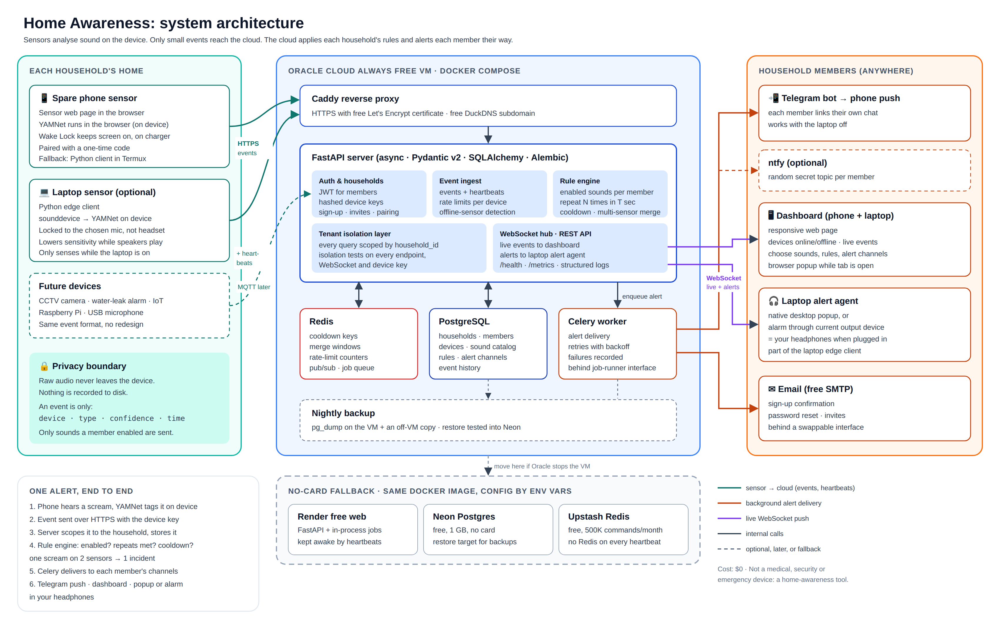

# Home Awareness System: Design

Date: 2026-11-06
Status: ready for author review

## 1. Intent and why

The author was working on a laptop wearing headphones when their mother had a nightmare and screamed. They did not hear it and only noticed when the music ended. This project exists so that a sound in the house can reach a person even when headphones (or distance, or a closed door) block it out.

It is also a portfolio project. The author is a backend engineer who has built a health-checkup CRUD app and an insurance-prediction ML endpoint with FastAPI. This project should show production-style Python backend engineering, with a small amount of AI at the edge. The engineering carries the weight, not the model.

## 2. What it is

A **home-awareness product**: any household can sign up, add sensors around their home that listen locally for sounds they care about, and get alerted in the way each member chose. Sensors report only short events to a cloud-hosted FastAPI server. The author's family is the first household using it (author's decision: build it as a product other households can sign up for).

It is **not** a medical device, a security alarm, or an emergency service. The README and the app must say so plainly.

## 3. Goals, non-goals, anti-goals

### Goals
- Detect user-selected sounds on-device and alert the user through a channel that reaches them while wearing headphones.
- Let any household sign up, invite its members, and pair its own sensors, with each household's data fully isolated from every other (multi-tenancy).
- Support many sensor devices of different hardware types per household.
- Let each user choose which sounds matter, how many repeats trigger an alert, and how they are alerted.
- Cost $0 to build and run.
- Look and behave like production backend work: auth, async I/O, background jobs, rate limiting, migrations, tests, CI, Docker, observability.

### Non-goals (version 1)
- Camera or video detection. The camera idea is parked for later (see section 8).
- A native mobile app.
- Keyword/name spotting ("someone is calling my name"). Stretch goal only.
- Medical, emergency-services, or guaranteed-delivery behaviour.
- Payments, plans, or billing.
- Quiet hours and scheduling.

### Anti-goals (failure even if it technically works)
- Raw audio or video leaves a device or is stored anywhere.
- A flood of alerts, for example 50 screams producing 50 notifications.
- A sensor going silent without the user finding out.
- Claiming reliability the system does not have.
- One household able to see or affect another household's devices, events, or settings.

## 4. Architecture

Source: `architecture.svg`.

Three parts:

1. **Edge client** (Python program on a sensor device). Captures microphone audio, runs a pre-trained sound classifier locally, filters to the sounds the user enabled, and sends a small event to the server over HTTPS. Also sends periodic heartbeats.
2. **FastAPI server.** Receives events and heartbeats, stores history, applies each user's rules (repeat counts, cooldowns), and dispatches alerts. Pushes live updates to the dashboard.
3. **Dashboard** (responsive web page, works on phone and laptop). Shows devices and their online state, live and past events, and lets the user manage sounds, rules, and alert channels. Minimal by design; the backend is the showcase.

An event is generic: `device, event type, confidence, timestamp`. The server does not know or care what hardware produced it. That is what lets CCTV cameras, water-leak alarms, and IoT sensors join later (MQTT adapter) without redesign.

## 5. Sound and event catalog

All sounds are **off by default**, except the three marked "default on". The catalog is data, not code, so adding a sound later needs no server redesign. Each sound has a reliability label shown to the user.

| Group | Sound | Default | Expected reliability |
|---|---|---|---|
| Distress | Scream | on | good |
| Distress | Shouting / yelling | off | fair |
| Distress | Crying (baby or adult) | off | good |
| Distress | Moaning | off | experimental |
| Distress | Gasping / choking | off | experimental |
| Distress | Long coughing fit | off | fair |
| Intrusion | Glass breaking | on | good |
| Intrusion | Door slam / forced knock | off | fair |
| Intrusion | Repeated knocking / banging | off | fair |
| Intrusion | Car alarm | off | good |
| Intrusion | Dog barking | off | good |
| Hazard | Smoke / fire alarm | on | good |
| Hazard | Siren | off | good |
| Hazard | Loud bang / explosion | off | fair |
| Hazard | Running water / tap left on | off | fair |
| Accident | Loud thud / fall | off | experimental |
| Household | Doorbell | off | good |

Reliability labels are estimates, not measured. An early task must measure each sound on real recordings and set the labels from results.

## 6. Rules and alerting

- **Enabled sounds:** a user picks which sounds matter. A sound the user has not enabled is dropped on the device and never sent.
- **Repeat rule:** "same event N times within T seconds, then alert", usable for any sound (for example, dog barks 5 times in 1 minute). A single bark does nothing; a burst alerts.
- **Cooldown:** after an alert for an event type on a device, further matching events are logged but do not alert again for a set period. This prevents floods.
- **Alert channels, chosen per user:** silent popup on the dashboard or laptop, sound alarm, and phone push notification. The user can mix them and can turn the alarm sound off in favour of a popup.
- **Phone push in v1:** ntfy or a Telegram bot (free, outbound only, no public address needed). Firebase push is a later option.
- **"I'm on it" (author approved from the dashboard mockup):** any member can acknowledge an alert. Everyone else in the household sees who is handling it, live, so three people don't all run in.
- **Test alert (author approved from the dashboard mockup):** a member can send themselves a test alert through all their enabled channels.
- **Delivery is best-effort.** Alert delivery runs as a background job with retries, and failures are recorded.

## 7. Devices

- Any device can be a sensor: the laptop, a spare phone, a Raspberry Pi, or a USB microphone.
- Each device registers with the server and gets its own **hashed, revocable API key**. Users log in with JWT.
- Devices send **heartbeats**. If a device stops, the server warns the user that the sensor is offline, because a silent sensor is worse than none.
- **Microphone selection:** the edge client must let the user pick the input and default to the built-in or chosen mic. Plugging in a headset must not silently switch it to the headset mic.
- **Speaker playback:** loud movies or music through speakers can mask real sounds or trigger false alarms. The client should reduce sensitivity while the machine plays audio. This will not be perfect and the README should say so.
- **Placement matters:** a laptop mic hears little through a wall. Real coverage needs a sensor in the room being watched.
- **The laptop is optional.** The server is in the cloud, so alerts reach the phone with the laptop off. The laptop only senses and shows desktop popups while it is on.
- **Second sensor: the author's spare phone (author's decision).** It stays in the watched room, plugged in. My call: it runs a responsive sensor web page that uses the phone's microphone and runs the classifier in the browser, so no native app is needed. Mobile browsers stop the mic when the screen locks or the tab goes to the background, so the page uses the Screen Wake Lock API and the phone stays on its charger with the page open. If the browser path proves unreliable, the fallback is the Python edge client running in Termux on the same phone.

## 8. Privacy

- Audio is analysed on the device. Only an event (type, confidence, time, device) goes to the server.
- No raw audio is sent or stored. Nothing is recorded to disk.
- Camera and video are out of v1. If added later, the same rule applies: analyse locally, send events only.

> **Update 2026-11-09:** cameras are now supported, and the promise that audio and video never leave the device has one exception: a camera alert may carry a **single JPEG snapshot** (at most 640 px and 300 KB, only when the alert is raised and the camera's "Send snapshots" switch is on). The server stores it encrypted at rest, shows it only to household members, and deletes it after the household's retention setting (1, 7 or 30 days). Video is never sent. See [the camera spec](superpowers/specs/2026-11-08-camera-sensors-design.md) §2.

## 9. Product and multi-tenancy

- **Sign-up and households:** a person signs up with email and password and creates a household, or joins one through an invite link from an existing member. A household has an owner and members.
- **Isolation:** every household-owned row (devices, events, rules, alert channels) carries a household id. Every query is scoped by it in one shared layer, not by hand in each endpoint. Tests prove that one household cannot read or change another's data through any endpoint, WebSocket, or device key.
- **Device pairing (my call):** the dashboard shows a short one-time pairing code or QR code. The sensor enters it and receives its own device key, bound to that household. No household ever types a raw key.
- **Account lifecycle:** password reset, leaving a household, removing a member, revoking a device, and deleting a household with all its data.
- **Email (my call):** sign-up confirmation and password reset go through a free SMTP option (for example a Gmail app password or a free transactional-email tier, checked before use). It sits behind an interface so it can be swapped.
- **Abuse limits:** rate limits per IP on sign-up and login, and per device and per household on events, so one household cannot exhaust the shared free server.
- **Legal and trust pages:** a plain privacy note (what is stored: events, not audio), the home-awareness disclaimer, and a way to delete everything.

## 10. Hosting

- **The server runs in the cloud, always on (author's decision),** so alerts keep working when the author's laptop is off. The spare phone in the watched room is the always-on sensor; the laptop is optional and only adds desktop popups while it is on.
- **Main host: Oracle Cloud Always Free (author's decision).** An Always Free Arm VM (reportedly 2 OCPU / 12 GB since mid-2026) runs the full Docker Compose stack. The author adds a card for identity verification only and wants **no charges or future bills, ever**. Rules the setup guide must spell out: never upgrade the account to Pay As You Go; create only resources labelled "Always Free"; keep Arm usage within the free limit before the 30-day trial ends; sign in at least every 60 days. Oracle's docs say an un-upgraded account is not charged; some users report free VMs being stopped anyway, so backups and portability matter. Google Cloud is ruled out because its free tier keeps a live billing account that can charge on overage.
- **Fallback: no-card setup (author's decision).** Render free web service (app), Neon free Postgres, Upstash free Redis. None needs a card. Render sleeps after 15 minutes without traffic (sensor heartbeats every minute should keep it awake, to be tested), has 5 GB/month bandwidth and no free background worker. Upstash allows 500K commands a month.
- **Portability requirements (my calls), so the fallback is real and not theoretical:** all config through environment variables; one Docker image for both hosts; alert delivery behind a job-runner interface with two implementations, a Celery worker on Oracle and an in-process async runner on Render; Redis used for cooldowns, merge windows, and rate limits only, not on every heartbeat, so the Upstash budget holds; a documented, tested restore from the nightly backup into Neon.
- **HTTPS:** a free DuckDNS subdomain and Caddy with automatic Let's Encrypt certificates. This also gives the phone sensor page the HTTPS it needs for microphone access.
- **Backups:** a nightly `pg_dump` kept on the VM plus a copy off it (builder picks where, at $0).

## 11. Constraints

- **No deadline (author's answer).** The full v1 scope stands. Work is still ordered so a useful end-to-end slice (laptop sensor → server → laptop popup) works first.

- **$0 to build and run.** Everything is free and open source, hosted on a cloud free tier.
- Free GitHub Actions for CI requires a public repo.

## 12. Technology: who decided what

The author asked me to suggest and said they would review. None of these are agreed yet; they are **my calls** until the author confirms.

- FastAPI, Pydantic v2, async SQLAlchemy, Alembic migrations
- PostgreSQL for users, devices, rules, and event history
- Redis for cooldowns, de-duplication, rate limiting, and live pub/sub
- Celery with Redis for background alert delivery and retries on Oracle, behind an interface with an in-process fallback
- WebSockets for live dashboard updates
- Telegram bot for phone alerts (each user links their own chat), with ntfy on random secret topics as an option
- JWT for users; hashed per-device API keys
- Edge client in Python with `sounddevice` and a pre-trained YAMNet model run locally
- HTTPS for events and heartbeats now; MQTT later for IoT and sensors
- pytest, structured logging, a health and metrics endpoint, Docker Compose, GitHub Actions CI

The decisions the author made themselves: fresh project (not health/insurance), sensors of any hardware type, per-user selectable sounds and alert styles, on-device analysis with events-only to the server, laptop and phone as dashboard, the home-awareness framing, the $0 budget with no charges or future bills, Oracle as main host with a no-card fallback, and opening it as a product other households can sign up for.

## 13. Settled after builder review (my calls, author to check)

- **Alerts through headphones:** the laptop runs a small local alert agent as part of the edge client. It shows a native desktop notification and, if the user chose the alarm, plays a sound through the **current output device**, which is the headphones when they are plugged in. That is the point of the project. The dashboard also shows browser notifications, but only while a tab is open, so the browser is not the main path on the laptop.
- **Users and devices:** each household can have several users, and each user has their own enabled sounds, repeat rules and alert channels. Devices belong to the household and are shared. A device sends any sound that at least one user has enabled, and the server filters per user. Devices fetch this list from the server when they start and on each heartbeat.
- **One sound, several sensors:** events of the same type from different devices within a short window (a few seconds) count as one incident. Repeat counting and cooldowns apply per household, per event type, per user, so three sensors hearing one scream produce one alert. Redis holds the merge window and cooldown keys.
- **Accuracy measurement:** use ESC-50 and AudioSet clips where they exist, plus a few recordings made at home. A sound below a set precision/recall bar (the builder picks the bar and records it) is marked experimental, and one far below it is hidden.

## 14. Left to the builder

- Exact data model, endpoint shapes, and event schema.
- Which YAMNet class labels map to each catalog sound.
- Thresholds, default repeat counts, and cooldown lengths.
- Dashboard layout and styling.
- Project layout, test strategy, and order of work.

## 15. Known risks

- Falls, gasping, and moaning are weakly detectable. They ship as "experimental" or not at all.
- False alarms from media playback and background noise.
- Browser-based classification on a phone may be too heavy or unreliable.
- "Someone calls me N times" needs keyword spotting; deferred.
- Free-tier terms change (Oracle already halved its Arm allowance in 2026), Arm capacity can be scarce at sign-up, and free VMs have been stopped for some users; the no-card fallback must stay deployable.
- Holding other households' event history raises the stakes of any security bug.

## 16. What done looks like for v1

- `docker compose up` brings up the server, database, Redis, worker, and Caddy, locally and on the cloud VM.
- The server is live on Oracle Always Free over HTTPS, and stays up with the author's laptop off.
- The same image has been deployed once to the no-card fallback (Render + Neon + Upstash) and passed a smoke test.
- A new household can sign up, invite a member, and pair a sensor with a code; isolation tests pass.
- A laptop sensor and the spare-phone sensor register, send events, and show online or offline.
- A user can enable sounds, set a repeat rule, and receive a dashboard popup and a phone push for a real detected sound.
- Cooldown and repeat rules are covered by tests; CI runs on every push.
- The README has an architecture diagram, setup steps, the home-awareness disclaimer, and a measured accuracy table.
